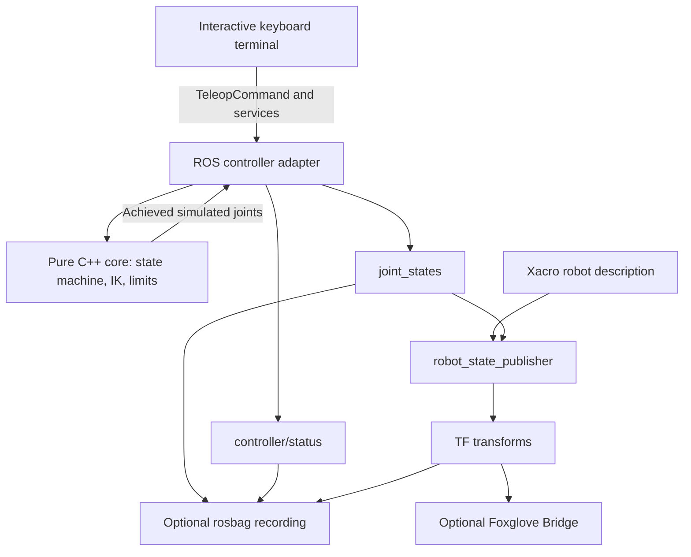

# HandPilot

A ROS-first learning repository for a two-link planar arm: modern C++, kinematics,
transforms, bounded keyboard teleoperation, tests, recording, and debugging.
This is **kinematic simulation**, not dynamics or physical robot control.

**Status: source authored; builds, tests, runtime, CI, and performance NOT RUN.**
Before building, supply a real maintainer email in all six package manifests.
The email fields are deliberately empty; ROS package validation will reject them.
No license has been selected. See [setup prerequisites](docs/TRANSFER_AND_SETUP.md)
and [validation status](docs/VALIDATION_STATUS.md).

## Architecture



| Package | Ownership |
| --- | --- |
| handpilot_interfaces | Generated input/status messages and engagement service |
| handpilot_core | ROS-independent C++17 FK, IK, Jacobian, constraints, state machine |
| handpilot_control | ROS clocks, parameters, services, sole simulated joint publisher |
| handpilot_teleop | Interactive keyboard velocity pulses and async service requests |
| handpilot_description | Primitive configurable Xacro arm |
| handpilot_bringup | Headless launch, shared config, optional visualization bridge |

## Transfer And Build

Authoring on Windows is file-only. ZIP the outer handpilot folder manually in
File Explorer, review contents, transfer through an approved route, and extract
on the Mac. Keep .git, build outputs, dependencies, keys, and recordings out.
Do not overwrite an edited destination. This project is separate from
~/handpilot_ws. Human command on macOS, not executed here:

```bash
scp -r ~/Downloads/handpilot ubuntu-ros2:/home/sahil/
```

Target: Ubuntu Server 24.04 ARM64, ROS 2 Jazzy ros-base and ros-dev-tools,
roughly 3 GB RAM and two virtual CPUs in UTM on an M2 MacBook Air.
After completing the manifest prerequisite, human commands on Ubuntu:

```bash
source /opt/ros/jazzy/setup.bash
cd ~/handpilot
rosdep install --from-paths src --ignore-src --rosdistro jazzy -y
CMAKE_BUILD_PARALLEL_LEVEL=2 colcon build \
  --symlink-install --executor sequential
source install/setup.bash
ros2 launch handpilot_bringup handpilot.launch.py
```

Use binary dependencies; do not build ROS itself. Do not sudo colcon or source
a half-built overlay from .bashrc. See [transfer/setup](docs/TRANSFER_AND_SETUP.md)
for rosdep initialization, metadata, and archive handling.

## Keyboard Terminal

In a separate interactive SSH terminal on Ubuntu:

```bash
source /opt/ros/jazzy/setup.bash
source ~/handpilot/install/setup.bash
ros2 run handpilot_teleop keyboard_node
```

`e` requests engagement, then `w/s` request +/-Y and `a/d` request -/+X.
Space requests HOLD; `r` resets FAULT; `q` quits with best-effort disengage.
Direction keys refresh a 0.35 s pulse, not a physical held-key deadman.
`e` starts an active-zero pulse to allow a following direction. If a pulse
expires, inactive heartbeat produces HOLD and requires another `e`.
Terminal autorepeat delays can therefore interrupt motion. Neither services
nor separate command topics have a guaranteed relative delivery order: inspect
responses and retry `e` when refused, never implement automatic engagement.

Expected examples, not captured results: startup status `DISENGAGED`; joint names
`shoulder_joint`, `elbow_joint`; successful input after engagement changes bounded
simulated joints; idle/expired input reports `HOLD` and a reason.

## Tests And Exploration

Human Ubuntu commands, after a successful build:

```bash
cd ~/handpilot
source /opt/ros/jazzy/setup.bash
source install/setup.bash
colcon test --executor sequential
colcon test-result --verbose
```

Start with the [learning guide](docs/LEARNING_GUIDE.md),
[control specification](docs/CONTROL_SPEC.md), [interfaces](docs/ROS_INTERFACES.md),
[run/debug guide](docs/RUN_AND_DEBUG.md), and [test plan](docs/TEST_PLAN.md).
[Recording/replay](docs/RECORD_AND_REPLAY.md) distinguishes recorded output from
live input. [Foxglove](docs/VISUALIZATION.md) is optional; ARM64 availability and
visualization are unverified. No camera, Node.js application runtime, Gazebo,
MoveIt, desktop, database, or cloud service is needed for keyboard mode.

## Limitations And Next Steps

HOLD freezes simulated state; it is not an emergency stop. No collision checking,
dynamics, hardware feedback, certified safety, or hard real-time guarantees.
Receiver freshness cannot rule out transport-delayed commands. Joint rate limiting
does not ensure straight Cartesian motion. Only one input source is intended.

Mac webcam input, possible rosbridge transport, controller comparisons, advanced
models, and deterministic replay are [planned](docs/ROADMAP.md), not implemented.
Do not publish a success badge or measured result before real validation.
Choose a license and publish the actual tested source copy following
[publication guidance](docs/PUBLISH_FROM_MAC.md).
