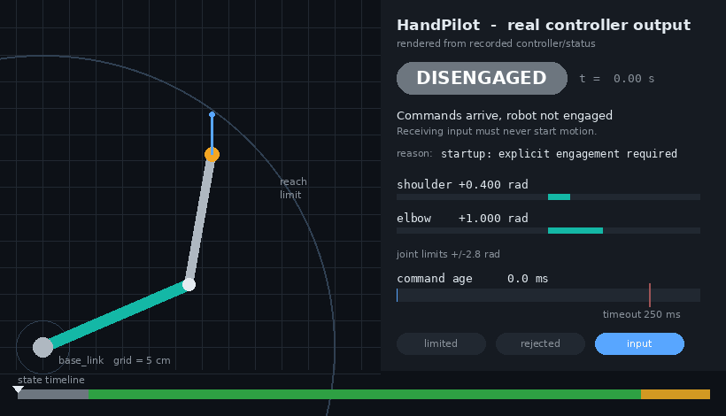
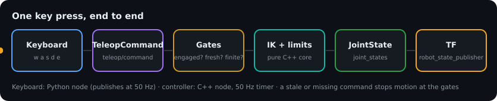
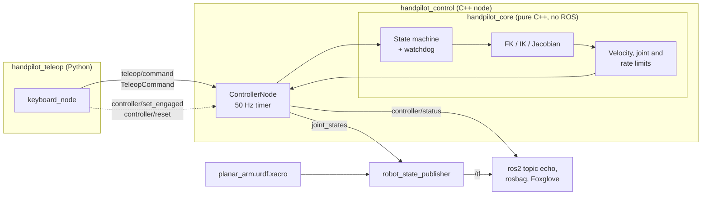
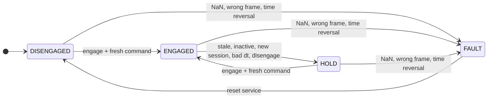
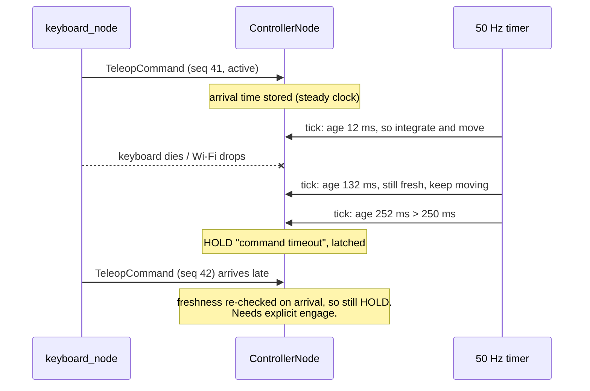
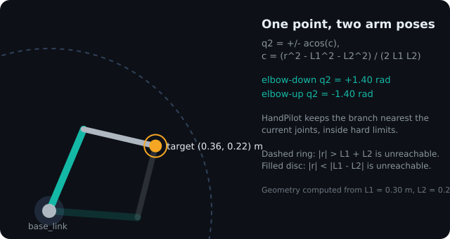

<div align="center">

# HandPilot

**Keyboard in, bounded robot motion out.**
A ROS 2 Jazzy + C++17 two-link arm that turns an imperfect stream of human commands
into motion that is limited, explainable, and stops when the input goes quiet.

[](https://github.com/SahilMalwanker/handpilot/actions/workflows/ci.yml)


-2ea043)



<sub>Every frame above is drawn from a <b>real recording</b> of <code>controller/status</code>
published by the controller node (<a href="docs/media/demo_session.csv">data</a>,
<a href="scripts/readme_media">scripts</a>). Nothing is hand-animated.</sub>

</div>

---

## What you are looking at

The GIF is one scripted operator session against the real `controller_node`:

| Time | Operator does | Controller does |
| --- | --- | --- |
| 0.0 s | Sends velocity commands without engaging | **Nothing moves.** Receiving input never engages the robot. |
| 1.2 s | Calls the `set_engaged` service | ENGAGED, target synced to the current pose, so there's no jump |
| 1.5 s | Streams a circular velocity | Integrates `target = achieved + v·dt` every 20 ms and solves IK |
| 7.8 s | Pushes outward past full reach | Joint rates saturate, then IK **rejects** the unreachable step and the arm parks at 0.548 m of 0.55 m |
| 10.4 s | Stops publishing | Watchdog: command age 263 ms > 250 ms timeout, so **HOLD** |

> **The central question:** how do you turn an imperfect stream of human commands
> into bounded, understandable robot behavior, and prove what happens when something
> goes wrong?

## How a key press becomes motion





The core library never reads a clock and has no ROS code. The node passes it explicit
time (`now`, `dt`), which lets the unit tests replay timeouts, clock jumps and faults
deterministically without starting ROS.

## The safety-relevant state machine



HOLD and FAULT are **latched**: no message brings the arm back by itself. A human
must call the service again. For PLC engineers: think enable interlock plus
communication-timeout supervision. It's software behavior, not a certified safety
function.

### What stops motion when commands go stale?



The age check runs **twice**: on every timer tick and when a late message arrives,
so a message arriving just before a tick can't hide a gap.

## The math

**Forward kinematics** (joint angles to tool position), with $L_1 = 0.30$ m, $L_2 = 0.25$ m:

$$
x = L_1\cos q_1 + L_2\cos(q_1+q_2), \qquad y = L_1\sin q_1 + L_2\sin(q_1+q_2)
$$

**Inverse kinematics** (tool position to angles) usually has two answers:



HandPilot evaluates both branches plus their ±2π equivalents, discards any outside
the hard joint limits, and picks the one closest to the current joints. Outside the
annulus $|L_1 - L_2| \le r \le L_1 + L_2$, it returns an explicit failure instead of
"some numbers".

**Jacobian** (joint velocity to tool velocity), $\dot{\mathbf p} = J(\mathbf q)\,\dot{\mathbf q}$:

$$
J(\mathbf q) = \begin{bmatrix}
-L_1\sin q_1 - L_2\sin(q_1+q_2) & -L_2\sin(q_1+q_2) \\
\phantom{-}L_1\cos q_1 + L_2\cos(q_1+q_2) & \phantom{-}L_2\cos(q_1+q_2)
\end{bmatrix}
$$

Implemented and tested against finite differences. Using it for singularity-aware
velocity control is a planned next step.

**One control tick** (default 50 Hz, $\Delta t \approx 0.02$ s):

$$
\mathbf p_{\text{req}} = \mathbf p_{\text{achieved}} + \operatorname{clamp}_{\lVert\cdot\rVert \le 0.12}(\mathbf v_{\text{cmd}})\,\Delta t
\;\xrightarrow{\text{IK}}\; \mathbf q_{\text{goal}}
\;\xrightarrow{|\Delta q_i| \le 0.8\,\Delta t}\; \mathbf q_{\text{new}}
$$

The next tick starts from what was actually **achieved**, not from what was requested.
Unreachable or rate-limited error is discarded instead of piling up (anti-windup),
which is why the arm in the GIF stops cleanly at the boundary.

## Quick start

On Ubuntu 24.04 with ROS 2 Jazzy (`ros-base` + `ros-dev-tools`):

```bash
source /opt/ros/jazzy/setup.bash
cd ~/handpilot
rosdep install --from-paths src --ignore-src --rosdistro jazzy -y
CMAKE_BUILD_PARALLEL_LEVEL=2 colcon build --symlink-install --executor sequential
source install/setup.bash
ros2 launch handpilot_bringup handpilot.launch.py
```

In a **second interactive terminal**:

```bash
source /opt/ros/jazzy/setup.bash && source ~/handpilot/install/setup.bash
ros2 run handpilot_teleop keyboard_node
```

| Key | Effect |
| --- | --- |
| `e` | Request engagement (sends a short active-zero pulse first) |
| `w` `s` | Tool velocity +Y / −Y |
| `a` `d` | Tool velocity −X / +X |
| `Space` | HOLD |
| `r` | Reset from FAULT |
| `q` | Quit with best-effort stop |

Each key press is valid for **0.35 s**. If your terminal's key-repeat delay is longer
than that, holding a key will let the pulse expire, and you'll see HOLD. That's the
watchdog working; press `e` again.

Watch it think in a third terminal:

```bash
ros2 topic echo /controller/status      # state, reason, requested vs achieved, command age
ros2 topic echo /joint_states
ros2 run tf2_ros tf2_echo base_link tool_link
```

## Tests

```bash
colcon test --executor sequential && colcon test-result --verbose
```

| Suite | Cases | What it proves |
| --- | ---: | --- |
| `test_kinematics` (gtest) | 6 | FK values, IK round trips, both branches, unreachable targets, Jacobian vs finite differences |
| `test_constraints` (gtest) | 4 | Cartesian speed cap, joint rate and position limits, invalid `dt` and config |
| `test_controller` (gtest) | 13 | No motion while stopped, no jump on engage, stale and inactive HOLD, sequence and session rules, NaN faults, reset |
| `test_keyboard_mapping` (pytest) | 21 | Key mapping, pulse expiry, stop clearing |
| `test_controller_integration` (launch_testing) | 2 | Real node: engage, move, HOLD on silence, FAULT on bad frame, reset, clean shutdown |
| `test_model_agreement` (launch_testing) | 2 | Full launch with changed link lengths: TF `tool_link` = FK = controller within 1 µm |
| `test_keyboard_terminal` (launch_testing) | 3 | Real `keyboard_node` on a pseudo-terminal: keys move the arm, `q` and Ctrl-C stop it, terminal restored |

All 51 pass on Ubuntu 24.04.5 aarch64 / Jazzy / GCC 13.3 with zero compiler warnings,
and in GitHub Actions on x86_64.
Full evidence, including what is **not** yet verified, is in
[docs/VALIDATION_STATUS.md](docs/VALIDATION_STATUS.md).

## Repository map

| Package | Role |
| --- | --- |
| [`handpilot_interfaces`](src/handpilot_interfaces) | `TeleopCommand.msg`, `ControllerStatus.msg`, `SetEngaged.srv` |
| [`handpilot_core`](src/handpilot_core) | ROS-free C++17: FK, IK, Jacobian, constraints, state machine |
| [`handpilot_control`](src/handpilot_control) | ROS node: timer, subscription, services; sole publisher of `joint_states` |
| [`handpilot_teleop`](src/handpilot_teleop) | Python keyboard node: velocity pulses, async service calls |
| [`handpilot_description`](src/handpilot_description) | Xacro model; link lengths shared with the controller |
| [`handpilot_bringup`](src/handpilot_bringup) | Launch file, `controller.yaml`, optional Foxglove bridge |

**Where to start reading:** [`TeleopCommand.msg`](src/handpilot_interfaces/msg/TeleopCommand.msg),
then [`Controller::receive`](src/handpilot_core/src/controller.cpp), then
[`Controller::step`](src/handpilot_core/src/controller.cpp). Those three explain one
command's whole journey and why stale input cannot move the arm.

Deeper docs: [learning guide](docs/LEARNING_GUIDE.md) ·
[control spec](docs/CONTROL_SPEC.md) · [ROS interfaces](docs/ROS_INTERFACES.md) ·
[architecture](docs/ARCHITECTURE.md) · [run & debug](docs/RUN_AND_DEBUG.md) ·
[test plan](docs/TEST_PLAN.md) · [roadmap](docs/ROADMAP.md)

## Honest limits

- **Kinematic simulation only.** No dynamics, torque, friction, contact or collision checking.
- **HOLD is not an emergency stop.** It freezes simulated joints. Nothing here is certified safety.
- **Not hard real-time.** A ROS timer on a Linux VM isn't a deterministic PLC scan; timing is unmeasured.
- **Paths can curve.** Joint rate limiting doesn't preserve straight Cartesian lines (visible in the GIF near full reach).
- **One input source.** A second publisher interrupts operation; there's no arbitration.
- **Not yet verified:** your own terminal's key-repeat feel and a Foxglove desktop client.

## Roadmap

Webcam hand tracking as a drop-in replacement for the keyboard (same `TeleopCommand`
contract), Jacobian-based velocity control near singularities, rosbag record and
replay analysis, and controller comparisons. See [docs/ROADMAP.md](docs/ROADMAP.md).

## License

[Apache-2.0](LICENSE). The same license ROS 2 itself uses for most of its core packages.
