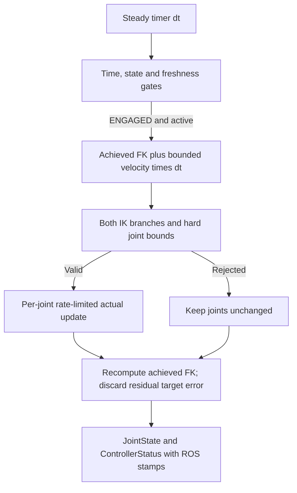

# Architecture

## Ownership

`handpilot_core::Controller` is the single mutable simulation state, owned by
`ControllerNode`. Its inputs are plain values and caller-supplied steady seconds.
The library has no ROS includes or environmental dependencies. FK/Jacobian math
expects valid configuration/joints; IK and the controller validate their inputs.
The low-level constraint helpers report limiting; callers must not treat a fallback
as a successful IK solution. The controller never publishes requested joints.

`handpilot_interfaces` generates language bindings at build time. `handpilot_control`
translates commands, parameter startup values, service actions, and timer intervals.
The single-threaded executor serializes callbacks. There is no custom scheduler,
plugin manager, lifecycle-node API, background service wait, or extra state owner.
The ordinary node lifecycle is constructor -> executor callbacks -> shutdown.

`handpilot_teleop` polls a real terminal with cbreak mode under a finally-protected
context. Pure mapping/window classes can be imported without rclpy. The ROS class
is created only by the executable factory. Pending service requests are asynchronous;
an explicit stop is queued behind a pending service while inactive commands are sent
immediately, preventing queued engage from being the final requested service action.
Lost service responses can delay that stop service; the inactive input/watchdog remain
independent. There is no transport-level stop guarantee.

Terminal reads use select plus unbuffered single-byte os.read, avoiding hidden text
read-ahead. Motion/engage keys are suppressed while an explicit stop is queued or
awaiting its response. Pulse times use an explicit start and deadline.

## Tick Data Flow

The timer defaults to 50 Hz but scheduling is not measured or hard real-time.
Watchdog evaluation occurs on ticks and before accepting a new command into an
engaged controller, so arrival after a long silence cannot conceal the gap.
At a tick gap > max_dt, HOLD replaces integration. ROS time jumps affect headers,
not watchdog or motion integration.

`handpilot_description` defines the same joint order/axes and a fixed tool endpoint.
`handpilot_bringup` reads installed YAML and supplies lengths/limits to Xacro and
controller consistently. robot_state_publisher derives TF from JointState; it does
not simulate motion. Optional bridge and bag recorder observe this graph.

One arm is intended. Namespaces scope topics/services; frame strings remain fixed
base_link/upper_arm_link/forearm_link/tool_link. Bringup remaps TF topics under the
namespace. Multi-arm frame prefixing and source arbitration are not implemented.
